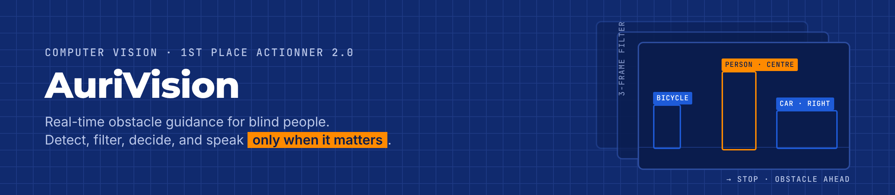
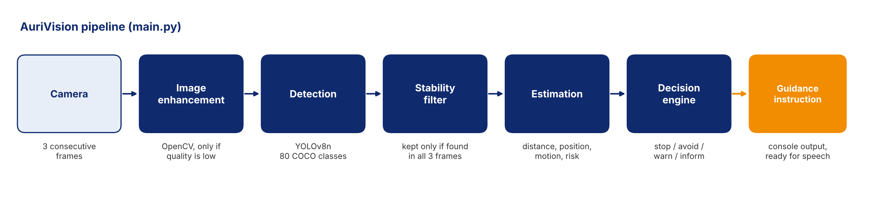

# AuriVision: computer-vision guidance prototype for blind people

A prototype that watches a camera feed, detects obstacles with YOLOv8, estimates how far and how dangerous they are, and turns this into short guidance instructions for a blind person. It won 1st place at Actionner 2.0 (ENSAM entrepreneurship competition, 2026).


[](#solution--architecture)
[](docs/)
[](#run-it-locally)

<!-- Demo: record a 5–10 s GIF (< 5 MB) of the live demo, save it as assets/demo.gif, then uncomment.
<p align="center">
  
  <br><em>Live demo: detected obstacles and the guidance instruction produced for each situation.</em>
</p>
-->

<p align="center">
  
  <br><em>From camera frames to a guidance instruction: only stable, relevant obstacles reach the decision engine.</em>
</p>

## TL;DR

- **Problem:** A white cane detects obstacles only within reach. It says nothing about a car, a cyclist or a person approaching a few metres ahead.
- **Solution:** A real-time pipeline that combines YOLOv8 detection, image enhancement (OpenCV), multi-frame stability filtering, distance and risk estimation, and a decision engine producing navigation instructions.
- **Result:** A working prototype. 1st place at Actionner 2.0 (ENSAM entrepreneurship competition, 2026) and 3rd place at the Enactus ENCG entrepreneurship competition (2026).

> **Prototype.** AuriVision has not been validated with users or measured for accuracy. It must not replace a white cane or a guide dog.

## Awards

| Competition | Organizer | Result | Year |
|---|---|---|---|
| Actionner 2.0 | ENSAM (entrepreneurship competition) | **1st place** | 2026 |
| Enactus ENCG entrepreneurship competition | Enactus ENCG | **3rd place** | 2026 |

## The problem

A guidance system for blind people has to do more than detect objects. It must decide what matters, and when to speak. Too many messages overload the user. A missed or false alarm is dangerous. The design goal was to speak only when necessary, put immediate dangers first, and keep instructions short.

## Solution & architecture

The main pipeline (`main.py`) processes the camera feed in windows of 3 consecutive frames.

- **Image enhancement (OpenCV):** each frame is scored on brightness, contrast, sharpness, noise, colour balance and saturation. Only the corrections a frame needs are applied, for example CLAHE when contrast is low. Good frames are left unchanged.
- **Detection (YOLOv8n):** objects from the 80 COCO classes, with a confidence threshold of 0.5.
- **Multi-frame stability filtering:** an object detected in the middle frame is kept only if it is matched (by IoU, intersection over union) in the two other frames. A stability score combines how stable its confidence, position and size are across the 3 frames. This removes one-frame false detections before they can trigger an alert.
- **Distance and risk estimation:** distance is estimated from one camera with a pinhole model: $d = \frac{\text{real height} \times f}{\text{box height in pixels}}$. It uses typical object sizes (person 1.7 m, car 4.5 m) and a fixed focal length. Each object also gets a position (left, centre, right), a motion estimate and a risk level by class (for example, a person or a bus is critical).
- **Decision engine:** produces one instruction with an urgency level. The rules apply in order: stop if a collision is imminent, avoid if the path ahead is blocked, warn if a danger is approaching, otherwise inform. A minimum of 2 s between messages, and a memory of recently announced obstacles, prevent repetition.
- **Output:** a colour-coded console message by urgency. This module is the place to plug in text-to-speech.

A lighter pipeline (`scripts/live_demo.py`) works frame by frame, without enhancement or the 3-frame filter. It is faster, and adds trajectory tracking and a collision-risk score per obstacle.

**Stack:** Python · YOLOv8 (Ultralytics) · OpenCV · NumPy

## My contribution

- Team lead (team of 4): coordinated the team and distributed tasks.
- Responsible for the machine learning / AI engineering part: the detection, filtering, estimation and decision pipeline.

## What I learned

- **The decision layer matters as much as detection.** A good detector is not enough: deciding what to say, and when to stay silent, shapes how useful the system is.
- **Stability before speed.** Requiring an object in 3 consecutive frames removes flickering false alarms, at the cost of latency (3 YOLO inferences per cycle).
- **Showing the prototype to a blind person** made the stakes concrete, and is why an evaluation with real users comes first in the next steps.

## Limitations & next steps

- **Limitation:** The prototype has not been evaluated: no accuracy, latency or user study has been measured. Distance estimates rely on a fixed focal length and average object sizes, so they are approximate, and the output is console text only.
- **Next step:** Calibrate the camera, add text-to-speech, merge the two pipelines into one, and evaluate detection and guidance with blind users.

## Run it locally

```bash
git clone https://github.com/CedricKonkobo/AuriVision.git
cd AuriVision
python -m venv aurivision_env
source aurivision_env/bin/activate        # Windows: aurivision_env\Scripts\activate
pip install -r requirements.txt
pip install -e .

python scripts/camera_index_check.py      # find your camera index
python -m aurivision.main                 # main pipeline (press 'q' to quit)
python scripts/live_demo.py               # lightweight frame-by-frame demo
```

The YOLOv8n weights (`models/yolov8n.pt`) are downloaded through Ultralytics if missing. Camera indices are set in `src/aurivision/config.py`.

## Repository structure

```
AuriVision/
├── assets/                  # figures and test images
├── docs/                    # documentation
├── models/                  # YOLOv8 weights (not versioned)
├── scripts/
│   ├── live_demo.py         # lightweight real-time demo
│   └── camera_index_check.py
├── src/aurivision/
│   ├── config.py            # paths and thresholds
│   ├── main.py              # multi-frame pipeline, live loop
│   ├── preprocessing/       # adaptive image enhancement
│   ├── detection/           # YOLOv8 + stability filter
│   ├── estimation/          # distance, risk, trajectory
│   └── decision/            # decision engines and output module
├── pyproject.toml
├── requirements.txt
└── README.md
```

---

**Cédric Konkobo** · AI & Data Engineering, ENSAM Rabat · [GitHub](https://github.com/CedricKonkobo) · [LinkedIn](https://www.linkedin.com/in/VOTRE-PROFIL)
